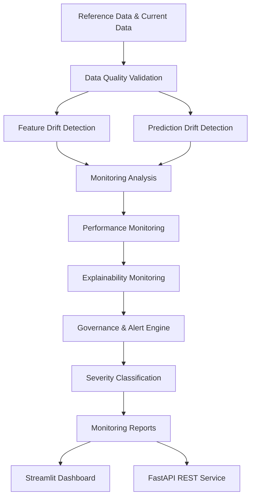

# Enterprise AI Governance, Model Drift Detection and Explainability Monitoring Platform

**Monitor AI Models. Detect Performance Drift. Ensure Transparent and Responsible AI.**

## Project Overview

An end-to-end AI model governance and monitoring platform designed to track machine learning model behaviour, identify data and prediction drift, evaluate model performance, and improve transparency through explainability monitoring. The platform integrates statistical monitoring techniques, data quality validation, performance evaluation, and model governance mechanisms to support reliable and responsible AI deployment. It leverages techniques such as **Population Stability Index (PSI), Statistical Distribution Analysis, Performance Monitoring, and Feature Importance Analysis** to identify changes in model inputs, predictions, and behaviour over time.

An interactive **Streamlit dashboard** and **FastAPI-based REST API** provide capabilities for model inventory management, drift analysis, monitoring reports, governance alerts, and explainability insights.

## Key Objectives

- Monitor machine learning models throughout their operational lifecycle.
- Detect changes in input data and prediction distributions.
- Identify potential model performance degradation.
- Evaluate feature-level distribution changes using statistical techniques.
- Monitor explainability signals and feature importance variations.
- Generate configurable alerts based on monitoring severity.
- Support transparent, auditable, and responsible AI governance.

## Core Features

| Feature | Description |
|---|---|
| Model Registry | Manage model metadata, ownership, versions, status, and risk tiers. |
| Data Quality Monitoring | Validate missing values, schema consistency, and numeric ranges. |
| Data Drift Detection | Identify feature distribution changes using Population Stability Index (PSI). |
| Prediction Drift Detection | Monitor changes in model prediction distributions. |
| Performance Monitoring | Evaluate accuracy, precision, recall, F1-score, and ROC-AUC when ground-truth labels are available. |
| Explainability Monitoring | Compare feature-importance snapshots and identify changes in model behaviour. |
| Governance Alerts | Generate configurable alerts with severity levels and recommended review actions. |
| Monitoring Dashboard | Explore model inventory, drift signals, monitoring runs, and alert history. |
| REST API | Access model inventory, health information, and monitoring summaries through FastAPI. |
| Audit Reporting | Maintain timestamped monitoring outputs for traceability and review. |

## System Architecture

The platform follows a modular AI governance workflow that integrates data quality validation, statistical drift detection, predictive performance monitoring, explainability analysis, and governance reporting.



## AI Governance & Monitoring Architecture

The platform incorporates multiple monitoring components to evaluate model reliability, operational behaviour, and transparency.

### 1. Model Registry

Maintains structured model information, including:

- Model name and identifier.
- Model version.
- Model owner.
- Deployment status.
- Model risk classification.
- Registration metadata.

### 2. Data Quality Monitoring

Evaluates incoming datasets to identify:

- Missing values.
- Schema inconsistencies.
- Unexpected data types.
- Invalid numerical ranges.
- Data validation failures.

### 3. Data Drift Detection

Uses **Population Stability Index (PSI)** to compare feature distributions between reference and current datasets.

This helps identify changes in incoming data that may affect model reliability.

### 4. Prediction Drift Detection

Compares prediction distributions across different monitoring periods to identify changes in model output behaviour.

### 5. Model Performance Monitoring

Evaluates model performance when ground-truth labels become available.

The monitoring process includes:

- Accuracy.
- Precision.
- Recall.
- F1-score.
- ROC-AUC.

### 6. Explainability Monitoring

Tracks feature-importance snapshots and compares changes across monitoring runs.

This provides an additional signal for reviewing changes in model behaviour and identifying features that may require investigation.

*Feature-importance changes alone do not establish model failure or explain individual predictions.*

## Key Monitoring Indicators

The platform evaluates several indicators to assess machine learning model health.

| Monitoring Area | Indicators |
|---|---|
| Data Quality | Missing values, schema consistency, invalid ranges. |
| Feature Drift | Population Stability Index (PSI). |
| Prediction Drift | Changes in prediction distributions. |
| Model Performance | Accuracy, precision, recall, F1-score, ROC-AUC. |
| Explainability | Feature importance and contribution changes. |
| Governance | Model ownership, version, risk tier, alert severity. |

## PSI Interpretation

Population Stability Index is used to measure changes in feature distributions between reference and current datasets.

The project uses the following illustrative interpretation:

| PSI Value | Interpretation |
|---|---|
| Below 0.10 | Low Distribution Shift |
| 0.10–0.25 | Moderate Distribution Shift |
| Above 0.25 | High Distribution Shift |

*These thresholds are conventional heuristics rather than universal standards. They should be calibrated according to the model, feature characteristics, sample size, and business context.*

## Technology Stack

| Category | Technologies |
|---|---|
| Programming | Python |
| Data Processing | Pandas, NumPy |
| Machine Learning | Scikit-learn |
| Statistical Monitoring | Population Stability Index (PSI), Distribution Analysis |
| Explainability | Feature Importance Analysis |
| Data Visualization | Matplotlib |
| Interactive Dashboard | Streamlit |
| Backend Development | FastAPI, Uvicorn |
| Model Management | Joblib |
| Testing | Pytest |
| Development Environment | Jupyter Notebook, VS Code |
| Version Control | Git, GitHub |

## Monitoring Methodology

1. **Data Collection** – Load reference datasets and current production-like data batches.
2. **Data Validation** – Check missing values, numerical ranges, and schema compatibility.
3. **Feature Drift Analysis** – Compare feature distributions using PSI.
4. **Prediction Drift Analysis** – Examine changes in model prediction distributions.
5. **Performance Evaluation** – Assess predictive performance when actual labels become available.
6. **Explainability Analysis** – Compare feature-importance snapshots across monitoring periods.
7. **Alert Generation** – Assign monitoring severity levels and recommended review actions.
8. **Governance Reporting** – Generate timestamped monitoring reports.
9. **Dashboard Integration** – Present monitoring results through interactive visualizations and API services.

## API Usage – Model Monitoring & Governance

The FastAPI service provides endpoints for accessing model information, application health, and monitoring summaries.

### Key Capabilities

- **Health Monitoring:** Check API service availability.
- **Model Inventory:** Retrieve registered model information.
- **Monitoring Summaries:** Access drift and model performance monitoring results.
- **Governance Insights:** Review monitoring alerts and model status information.

API documentation:

`http://127.0.0.1:8000/docs`

## Installation & Quick Start

**1. Clone the repository**

```bash id="wzq0p1"
git clone <your-repository-url>
cd <repository-folder>
```

**2. Create a virtual environment**

```bash id="v7k2m9"
python -m venv venv
```

**3. Activate the environment**

Windows:

```bash id="b8n4x2"
venv\Scripts\activate
```

Linux / macOS:

```bash id="p2f6r8"
source venv/bin/activate
```

**4. Install dependencies**

```bash id="m3c9v5"
pip install -r requirements.txt
```

**5. Generate synthetic monitoring data**

```bash id="q6h1k4"
python scripts/generate_data.py
```

**6. Execute the monitoring pipeline**

```bash id="t9e5w3"
python scripts/run_monitoring.py
```

**7. Launch the Streamlit dashboard**

```bash id="y4j8s2"
streamlit run dashboard/app.py
```

**8. Start the FastAPI backend**

```bash id="f5d2n7"
uvicorn api.main:app --reload
```

**9. Run automated tests**

```bash id="k1m6z9"
pytest -q
```

*Ensure that the commands and paths correspond to the actual implementation in your repository.*

## Repository Structure

```text id="u7c3a9"
AI_Model_Governance/
│
├── api/
│   └── main.py
│
├── config/
│   └── config.yaml
│
├── dashboard/
│   └── app.py
│
├── data/
│   ├── sample/
│   │   ├── reference_data.csv
│   │   └── current_data.csv
│   └── processed/
│
├── docs/
│   ├── 01_project_overview.md
│   ├── 02_problem_statement.md
│   ├── 03_objectives_and_scope.md
│   ├── 04_literature_review.md
│   ├── 05_system_architecture.md
│   ├── 06_ai_governance.md
│   ├── 07_data_quality_monitoring.md
│   ├── 08_data_drift_detection.md
│   ├── 09_prediction_drift.md
│   ├── 10_performance_monitoring.md
│   ├── 11_explainability_monitoring.md
│   ├── 12_population_stability_index.md
│   ├── 13_alert_management.md
│   ├── 14_model_registry.md
│   ├── 15_dashboard_documentation.md
│   ├── 16_api_documentation.md
│   ├── 17_testing_and_validation.md
│   ├── 18_security_and_privacy.md
│   ├── 19_limitations_and_future_work.md
│   └── 20_references.md
│
├── notebooks/
│   ├── 01_data_exploration.ipynb
│   ├── 02_data_quality_analysis.ipynb
│   ├── 03_feature_drift_detection.ipynb
│   ├── 04_prediction_drift_analysis.ipynb
│   ├── 05_performance_monitoring.ipynb
│   └── 06_explainability_analysis.ipynb
│
├── scripts/
│   ├── generate_data.py
│   └── run_monitoring.py
│
├── src/
│   └── ai_governance/
│       ├── __init__.py
│       ├── data.py
│       ├── drift.py
│       ├── quality.py
│       ├── performance.py
│       ├── explainability.py
│       ├── governance.py
│       └── pipeline.py
│
├── tests/
│   ├── test_data_quality.py
│   ├── test_drift.py
│   └── test_governance.py
│
├── .env.example
├── .gitignore
├── LICENSE
├── requirements.txt
└── pyproject.toml
```

## Limitations

The current implementation is designed as a research and educational demonstrator.

- Uses synthetic, batch-based tabular datasets.
- Relies on PSI as a baseline feature and prediction drift indicator.
- Uses a baseline classification model for performance monitoring.
- Evaluates performance only when ground-truth labels are available.
- Uses feature-importance comparisons rather than continuous local explainability.
- Provides configurable governance alerts rather than automated regulatory compliance.

## Future Enhancements & Roadmap

- Integrate dedicated model registry and lifecycle management systems.
- Implement automated monitoring schedules and continuous evaluation.
- Introduce data contracts and advanced data validation frameworks.
- Integrate Evidently AI and WhyLabs monitoring capabilities.
- Implement SHAP-based explainability monitoring.
- Introduce fairness evaluation and bias detection metrics.
- Develop automated alert notifications and incident routing.
- Implement approval workflows for model updates and deployment.
- Add advanced model performance and concept drift detection.
- Enable secure, scalable, multi-tenant cloud deployment.
- Integrate Docker and CI/CD pipelines for deployment automation.

## Security & Responsible AI Governance

This project is an educational and research-oriented AI governance prototype.

- Uses synthetic monitoring data by default.
- Does not automatically establish compliance with any regulatory framework.
- Requires appropriate access controls and audit retention for production use.
- Supports human review of monitoring alerts and recommended actions.
- Encourages continuous model validation and performance assessment.
- Requires documented governance policies and incident response procedures.
- Protects confidential datasets, model artifacts, credentials, and sensitive information.

Effective AI governance requires ongoing monitoring, documented accountability, risk assessment, and human oversight throughout the model lifecycle.

## Author

**Mohamed Riyaz S.**  
Integrated M.Tech – Computer Science and Engineering (Business Analytics)  
Vellore Institute of Technology (VIT), Chennai
